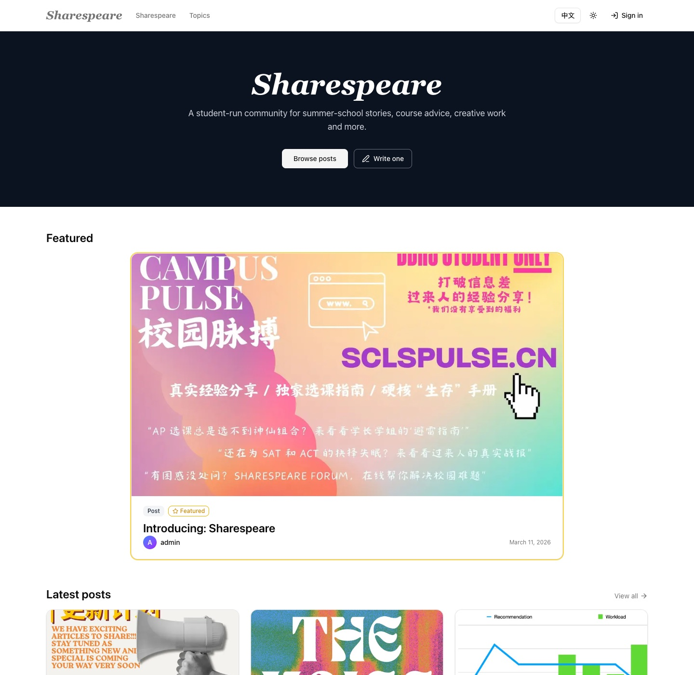
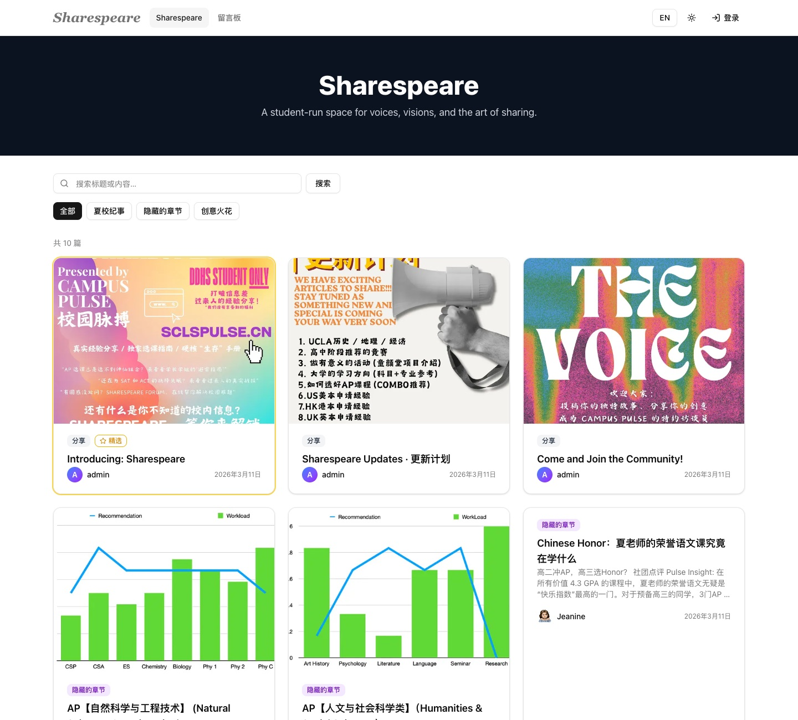
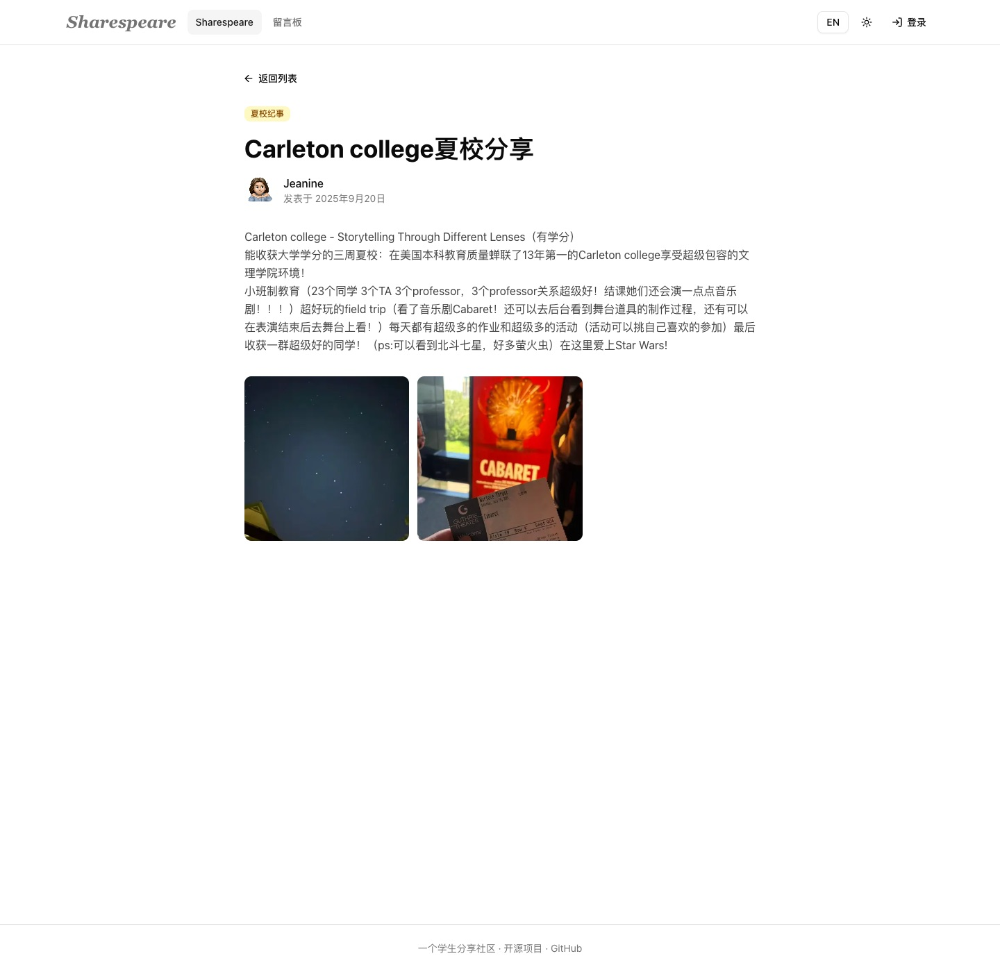
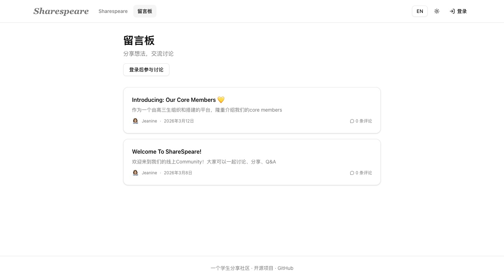
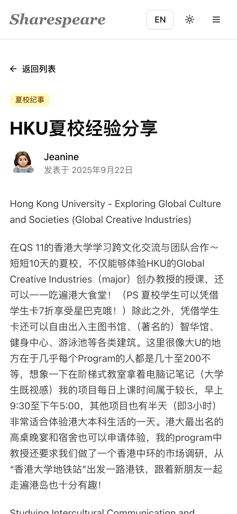
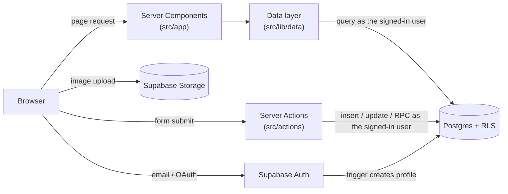

# Sharespeare

A bilingual (中文 / English) community site where high-school students share summer-school stories, course advice and creative work, and discuss them on a topic board.

**Live demo:** https://sharespeare-roan.vercel.app

> **中文简介**：Sharespeare 是一个由学生运营的分享社区——夏校纪事、选课心得、创作与故事，以及留言板讨论。注册即可发帖，内容先发后管：版主可以隐藏内容，用户可以举报。基于 Next.js 15 与 Supabase（Postgres + 行级安全）构建，中英双语。



| Posts | Post detail | Topics | Mobile |
|---|---|---|---|
|  |  |  |  |

## Features

- **Posts** — Markdown body, up to 9 images uploaded straight to storage, category tags, drafts, edit and delete your own posts
- **Topic board** — start a topic, comment, delete your own
- **Accounts** — email sign-up/sign-in with password reset; Google sign-in ready behind a flag
- **Post-moderation** — everything goes live immediately; moderators hide content, lock topics and pick a featured post; any user can report, and reports land in an admin queue
- **Bilingual** — every page renders server-side in Chinese or English
- **Responsive, dark mode**

## Tech stack

| | |
|---|---|
| Framework | Next.js 15 (App Router, React Server Components, Server Actions), React 19, TypeScript |
| Backend | Supabase: Postgres with Row Level Security, Auth, Storage |
| UI | Tailwind CSS 4, shadcn/ui (Radix) |
| Validation & content | zod, marked (Markdown), sanitize-html |
| Testing | Vitest; SQL-level RLS tests |

## Architecture



There is no separate API layer and no admin key on the server. Pages read data in Server Components and forms post to Server Actions; both create a Supabase client from the visitor's session cookie, so **every query runs as that user and the database decides what they may see or change**.

### Design decisions

**Authorization lives in the database.** Row Level Security policies and column-level `GRANT`s are the single source of truth ([`supabase/migrations`](supabase/migrations)). The app checks roles only to show or hide buttons and to return friendly errors; a bug in the UI can't grant extra access. For example, members may update `profiles.display_name` and `avatar_url` but not `role`, and may edit their own posts but not the moderation columns.

**Moderation through narrow database functions.** Hiding content and locking topics go through two `SECURITY DEFINER` functions (`set_content_hidden`, `set_topic_locked`) that check `is_mod()` themselves and also resolve open reports, instead of giving moderators broad `UPDATE` rights on every table.

**User content is sanitized on the way out.** Posts are stored as written (Markdown, or HTML for a few older posts) and rendered through one function that converts Markdown and then applies an allowlist with `sanitize-html` — no scripts, event handlers, inline styles or `javascript:` links; images must be HTTPS; links get `rel="noopener noreferrer nofollow"` ([`src/lib/html.ts`](src/lib/html.ts)).

**Server-rendered i18n.** The language preference is a cookie, so Server Components render the right language on the first response; switching language refreshes the server-rendered parts without a full reload ([`src/lib/i18n`](src/lib/i18n)).

**Uploads skip the server.** Images go from the browser to Supabase Storage under the user's folder; the Server Action only accepts URLs from this project's bucket.

### Data model

`profiles` (one per auth user, role `MEMBER` / `MOD` / `ADMIN`) · `sharespeare` (posts: title, Markdown body, image URLs, tag ids, `DRAFT`/`PUBLISHED`, `is_hidden`) · `tags` · `topics` → `comments` · `reports` (one per user per item) · `homepage_config` (featured post)

## Project structure

```
src/
  app/             routes: /, /sharespeare, /topics, /login, /me, /admin, /auth/callback …
  actions/         Server Actions (zod-validated writes)
  lib/data/        read queries that map rows to view models
  lib/supabase/    session-aware Supabase clients and generated DB types
  lib/html.ts      Markdown rendering + sanitizing
  lib/i18n/        dictionaries and server/client helpers
  components/      UI, including shadcn/ui primitives in components/ui
supabase/
  migrations/      schema, RLS policies and functions
  tests/           RLS tests
```

## Running locally

Requires Node.js 20+ and a Supabase project.

```bash
npm install
cp .env.example .env.local   # add your project URL and publishable key
npm run dev                  # http://localhost:3000
```

To set up a fresh database, run the files in [`supabase/migrations`](supabase/migrations) in order. In Supabase **Authentication → URL Configuration**, add `http://localhost:3000/**` to the redirect URLs so confirmation and password-reset emails link back to your local app.

## Testing

```bash
npm test            # Vitest unit tests (sanitizer, excerpts)
npm run typecheck
npm run lint
```

[`supabase/tests/rls_test.sql`](supabase/tests/rls_test.sql) checks the access rules from inside the database. It creates throwaway users, acts as an anonymous visitor, a member and a moderator, and asserts what each may do, for example that members can't edit others' posts, promote themselves, or comment on locked topics, and that hidden posts disappear for everyone but their author and moderators. It runs in one transaction that always rolls back, so it's safe against any database:

```bash
psql "$DATABASE_URL" -f supabase/tests/rls_test.sql
# → ERROR:  ALL RLS TESTS PASSED (rolled back)
```

## History

Sharespeare started in 2025 as a student-run news and sharing site at a high school in Shanghai. School rules at the time required real-name school email accounts and review of every post before publication, so the first version was built around a review queue. In 2026, with those requirements gone, I rebuilt it as an open community: post-moderation instead of pre-review, any email can sign up, authorization moved from scattered app code into the database, and unused sections were removed.

## License

[MIT](LICENSE)
